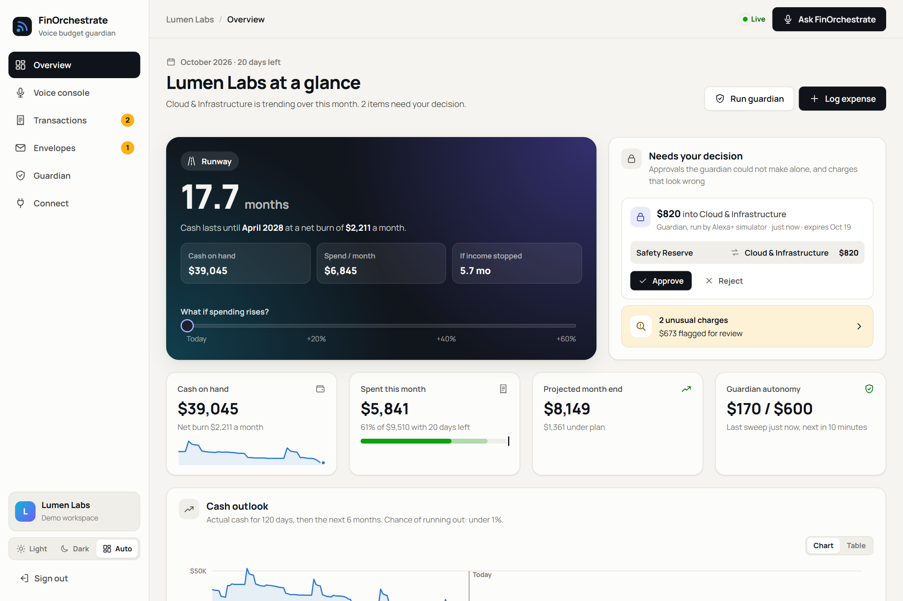
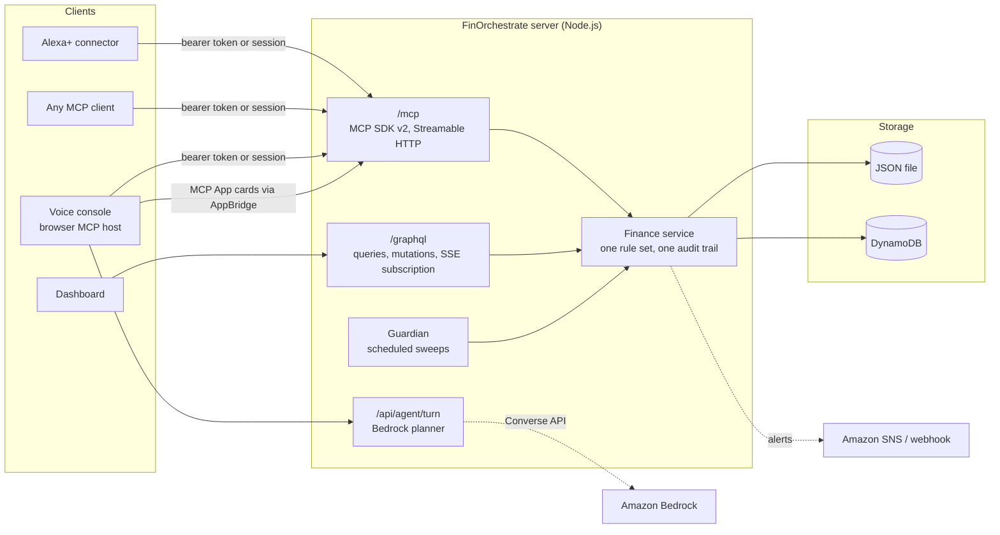

# FinOrchestrate

**A voice budget guardian for developer teams.** Ask Alexa+ about your cloud spend, log expenses by voice, and let an autonomous guardian keep your budget envelopes in balance, so a big bill never arrives as a surprise.

FinOrchestrate is a self-hosted **MCP server** (Model Context Protocol, spec **2025-11-25** and **2026-07-28** over **Streamable HTTP**) with **MCP Apps** cards, an **Agent Skill**, a live dashboard, and a browser based **Alexa+ simulator** that talks to the server exactly like an Alexa+ connector would.



## Why

Small product teams pay for AWS, model inference and a dozen SaaS seats. Those bills move fast and most teams only see them when the invoice lands: an S3 egress spike, a GPU run left on, a vendor that charged twice. Spreadsheets do not talk back, and finance tools are built for accountants, not for a founder who wants a straight answer between meetings.

FinOrchestrate answers in one sentence, by voice, from your real ledger:

> "How many months of runway do we have?"
> *"Net burn is about $2,211 a month against $39,045 in cash. That is 17.7 months of runway, which takes you to April 2028."*

And it acts on its own, inside limits you set:

> *"Guardian sweep done. I moved $170 from Safety Reserve to Dev Tools & SaaS on my own, I need your approval to move $820 into Cloud & Infrastructure, and I flagged 2 unusual charges."*

## What it does

| Capability | How it works |
|---|---|
| **Voice first answers** | 13 MCP tools, each returning a `speech` line written to be read aloud plus typed `structuredContent`. |
| **Autonomous guardian** | Projects every envelope to month end, moves small gaps on its own (default $250 per move, $600 a month, reserve first), asks for approval above that. Runs on a schedule (in process, or EventBridge Scheduler on AWS). |
| **Human in the loop** | Large voice moves and large guardian proposals become approvals you accept by voice ("approve it"), from an interactive card, or from the dashboard. |
| **Catches odd charges** | Duplicate detection plus robust outlier detection (median and MAD modified z-score) against each merchant's and envelope's own history. |
| **Can we afford it?** | Shows what a purchase does to its envelope and to runway, with the cheapest way to make room. One off or monthly. |
| **Remembers across sessions** | `get_briefing` keeps a cursor per client, so "what did I miss?" only reports what is new for that device or person. |
| **MCP Apps cards** | Every tool result renders as an interactive card (`ui://finorchestrate/card.html`) with approve, reject, "it was expected" and "make room" actions that call back into the server. |
| **Live dashboard** | GraphQL API with a live subscription: a voice command updates every open dashboard instantly. |
| **AWS native option** | DynamoDB storage, Amazon Bedrock (Converse API, Amazon Nova by default) as the console's planner, Amazon SNS alerts, EventBridge Scheduler, all on one Lambda container image. |

## Quick start

Requirements: Node.js 20.19 or newer (22 recommended).

```bash
npm install
```

```bash
npm run dev
```

- Dashboard: <http://localhost:5173> (choose **Explore the demo workspace**)
- MCP endpoint: <http://localhost:8787/mcp> (the API token is printed in the server log and stored in `data/secrets.json`)

The demo workspace is **Lumen Labs**, a four person studio with five months of history generated relative to today, including an S3 egress spike and a duplicated Datadog charge for the guardian to find.

### Try these in the voice console

Open **Voice console** and tap the microphone (Chrome or Edge) or type:

1. "How is the budget looking this month?"
2. "Run the guardian"
3. "Anything waiting for my approval?" then press **Approve** on the card, or say "approve it"
4. "Can we afford a 600 dollar GPU run?"
5. "What if cloud costs go up 25 percent?"
6. "Log forty two dollars for Bedrock inference"
7. "What did I miss?"

The **Protocol inspector** beside the conversation shows every JSON-RPC message on the wire, including tool calls made by the cards themselves.

### Production build

```bash
npm run build
```

```bash
npm start
```

`npm start` serves the dashboard, the MCP endpoint and GraphQL from one Node process on port 8787. In production set `FINO_API_TOKEN` (required) and `FINO_PUBLIC_URL`. See [.env.example](.env.example) for every option.

## Connect Alexa+ or any MCP client

The server speaks MCP over Streamable HTTP with bearer token authentication. A remote MCP client configuration looks like this:

```json
{
  "mcpServers": {
    "finorchestrate": {
      "type": "http",
      "url": "https://your-host/mcp",
      "headers": { "Authorization": "Bearer <FINO_API_TOKEN>" }
    }
  }
}
```

The dashboard's **Connect** page reveals the token, fills it into ready to copy snippets (MCP client, curl, MCP Inspector) and tests the connection live. For Alexa+, register the same endpoint and token in your connector; the server must be reachable over HTTPS (deploy it, or tunnel your local port).

The **Agent Skill** in [skills/budget-guardian](skills/budget-guardian/SKILL.md) teaches any skill capable agent how to run a spoken budget conversation with these tools: playbooks for briefings, purchases, approvals and anomaly triage, plus voice style and safety rules.

### MCP surface

| Tool | Purpose |
|---|---|
| `get_budget_status` | This month's envelopes, or one envelope in detail |
| `log_expense` / `log_income` | Record money out or in; expenses are auto categorised and checked for anomalies |
| `get_runway` | Cash, net burn and months left, with optional "what if spending rises X%" |
| `forecast_cash` | 1 to 12 month projection with a 10th to 90th percentile band and shortfall probability |
| `audit_spending` | Duplicates and outliers with a plain language reason each |
| `check_affordability` | Verdict, envelope impact, runway impact and a way to make room |
| `move_budget` | Move limit between envelopes; large voice moves wait for approval |
| `list_approvals` / `resolve_approval` | Review and decide pending changes ("approve it" acts on the newest) |
| `run_guardian` | Run a sweep now (idempotent) |
| `get_briefing` | What changed since this client last asked |
| `review_transaction` | Clear a flag after the owner confirms a charge |

Also: resources `finorchestrate://ledger/overview`, `finorchestrate://guardian/policy` and the MCP App view; prompts `weekly_review` and `purchase_check`. Every tool declares input and output schemas and behavior annotations (read only, idempotent, destructive). Details in [docs/mcp.md](docs/mcp.md).

## Architecture



- **`packages/core`**: the domain, framework free. Integer cent money, seasonal month end projection, runway and a random walk cash forecast, anomaly detection, the guardian planner, the voice intent engine and the card payloads. Fully unit tested.
- **`apps/server`**: one HTTP server hosting the MCP endpoint (`createMcpHandler` from the official SDK, serving both protocol eras), GraphQL Yoga, session auth, the Bedrock planner proxy, the scheduler and storage adapters (file, memory, DynamoDB).
- **`apps/card`**: the MCP App view, built into one self contained HTML file and served as a `ui://` resource.
- **`apps/web`**: the React dashboard and the voice console. The console is a real MCP host: official client SDK, `AppBridge` for cards in sandboxed iframes, Web Speech API for voice in and out.
- **`packages/icons`**: the product's own icon set, shared by the dashboard and the card.

More in [docs/architecture.md](docs/architecture.md). Problems hit along the way, with workarounds and suggestions for the tool owners, are in [docs/friction-log.md](docs/friction-log.md).

## Deploy on AWS

`infra/aws/template.yaml` (AWS SAM) deploys one container image to AWS Lambda behind a Function URL, with a DynamoDB table, an SNS topic for alerts and an EventBridge Scheduler rule that runs the guardian sweep. The Lambda Web Adapter forwards both HTTP requests and the scheduled event to the same Node server.

```bash
sam build --template infra/aws/template.yaml
```

```bash
sam deploy --guided --template .aws-sam/build/template.yaml
```

Step by step instructions, Bedrock model access and cost notes are in [docs/deploy-aws.md](docs/deploy-aws.md). The same `Dockerfile` runs on any container host.

## Quality

```bash
npm test
```

```bash
npm run typecheck
```

- 88 tests: domain math and guardian decisions, the voice intent engine, the MCP server driven by the official client over Streamable HTTP in both protocol eras, the HTTP surface (auth, DNS rebinding protection, CSRF hardening, GraphQL), and the AWS adapters against mocked AWS clients.
- Strict TypeScript everywhere, CI on every push ([.github/workflows/ci.yml](.github/workflows/ci.yml)).
- Security: bearer tokens compared in constant time, signed HttpOnly SameSite=Strict sessions, Host and Origin validation against DNS rebinding, rate limits on sign in and the planner, a strict Content Security Policy that allows exactly the card's hashed inline code, and MCP App cards in sandboxed iframes with an opaque origin.
- Accessibility: keyboard reachable custom controls (listbox, switch, slider, segmented control), charts with keyboard readable crosshairs and a table view, status never shown by color alone, reduced motion support, light and dark themes, layouts from 320px up.

## Project layout

```
apps/
  card/      MCP App view (single file HTML)
  server/    MCP, GraphQL and API server, storage adapters, scheduler
  web/       Dashboard and voice console
packages/
  core/      Domain logic and tests
  icons/     Shared icon set
skills/
  budget-guardian/   Agent Skill
infra/aws/   AWS SAM template
docs/        Architecture, MCP reference, AWS deployment
```

## License

[MIT](LICENSE)
